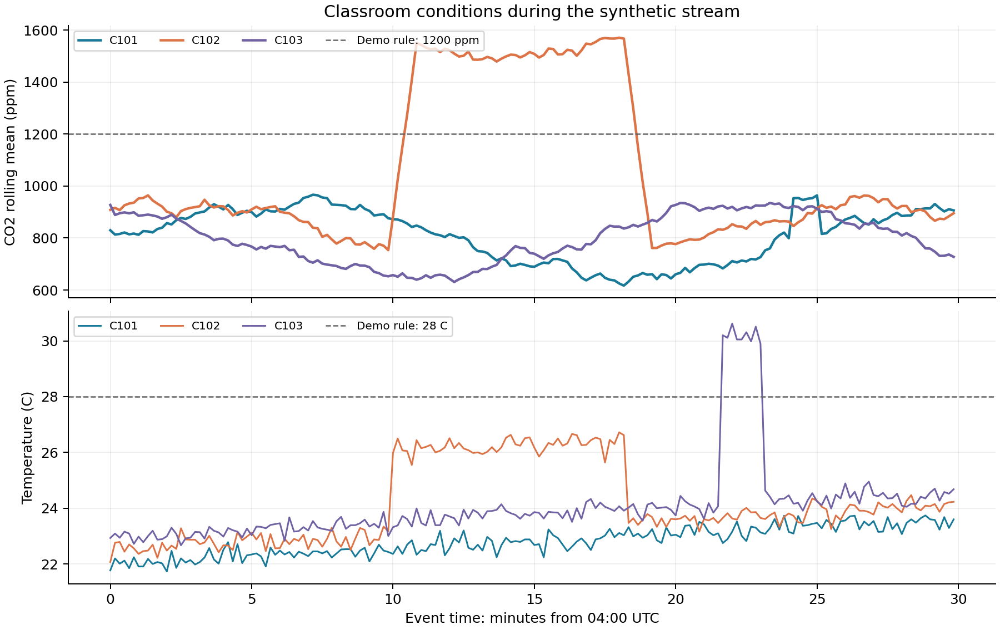
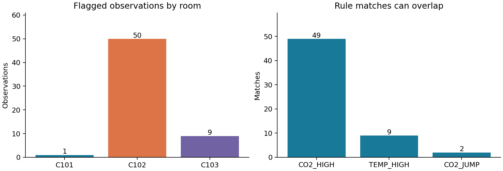

# Smart Campus Classroom Monitoring

**Authors:** Daniyar Sharipov, Zhanashev Aibyn · **Group:** BDA-2404  
**Course:** Real-Time Data Analysis and Decision Making  
**Project:** Midterm — Real-Time Data Collection and Stream Processing System

This project receives synthetic classroom observations one at a time, cleans them,
updates a separate 60-second window for each room, and detects rule-based events.
The console updates while the stream is running. CSV and JSONL files are flushed
after each incoming record. Final tables and charts are created after the run.

The dataset is generated, not measured at a university. The thresholds are
demonstration settings, not official environmental or health standards.

## Requirements

- Python 3.11 or newer; tested with Python 3.12.14.
- NumPy 2.3.5, Pandas 2.2.3 and Matplotlib 3.10.8, pinned in `requirements.txt`.
- Internet is only needed to install dependencies. Streaming and replay are offline.
- The optional notebook requires a Jupyter environment. The main project does not.

## Install and run

Extract the full ZIP and open a terminal in the `Smart_Campus_Midterm` folder.

```bash
python -m venv .venv
```

Activate it on Windows PowerShell:

```powershell
.\.venv\Scripts\Activate.ps1
```

Or on macOS and Linux:

```bash
source .venv/bin/activate
```

```bash
python -m pip install -r requirements.txt
python main.py --delay 0.05 --print-every 15 --output outputs/my_demo
```

If PowerShell blocks activation, call `.\.venv\Scripts\python.exe` instead of
`python` in the last two commands. Activation is optional when using that path.

The full run contains 180 observations per room and one injected duplicate.
At `--delay 0.05`, artificial waiting totals about 27 seconds, plus processing and
plotting time. Stop with Ctrl+C to keep the observations processed so far.

Every output folder must be new or empty. Choose another `--output` for each run.
Existing results are protected from accidental overwriting.

## Reproduce the submitted results

```bash
python main.py --seed 42 --steps 180 --delay 0 --output outputs/reproduced
python main.py --input data/classroom_stream.jsonl --delay 0 --output outputs/replayed
```

The first command regenerates the data. The second reads the supplied input file
line by line. With the pinned versions, both reproduce the submitted CSV results
in `outputs/reference`. Paths and source metadata in the manifests differ.

For a short visible demonstration:

```bash
python main.py --steps 12 --delay 0.3 --print-every 1 --output outputs/short_demo
```

This short run demonstrates acquisition and missing-value filling. It ends before
the injected anomaly periods. Use the full 180-step run to show all three rules.
`--print-every 1` displays every accepted record; alert and rejection messages are
always shown when printing is enabled. `--print-every 0` disables console printing.

## Project files

| File | Purpose |
|---|---|
| `main.py` | Run the stream, update the console and write run metadata |
| `campus/config.py` | Rooms, sampling interval, window and rule settings |
| `campus/source.py` | Seeded generator, line-by-line replay and pacing |
| `campus/processing.py` | Validation, causal cleaning, window metrics and rules |
| `campus/storage.py` | Incremental CSV and JSONL storage |
| `campus/visuals.py` | Final grouped table and two figures |
| `data/classroom_stream.jsonl` | Complete raw input, including deliberate errors |
| `Midterm_Daniyar_Sharipov_Zhanashev_Aibyn.ipynb` | Executed companion notebook with analysis |
| `Midterm_Report_Daniyar_Sharipov_Zhanashev_Aibyn.docx` | Seven-page technical report in English |
| `outputs/reference/` | Complete submitted results for seed 42 |

## Source and schema

Three fictional rooms, C101, C102 and C103, each produce one observation every
10 seconds of **event time**. The source starts at 2026-09-28 04:00:00 UTC,
equivalent to 09:00 in Kazakhstan (UTC+5), and ends at 04:29:50 UTC.
The start date is part of the simulation, not a claim of a real measurement.

| Field | Meaning | Clean form |
|---|---|---|
| `event_id` | Room and sample index; duplicate detection key | Unique string |
| `timestamp` | When the simulated observation occurred | ISO 8601, UTC |
| `room` | Classroom identifier | C101, C102 or C103 |
| `temperature_c` | Simulated room temperature | Float, 0 to 50 C |
| `co2_ppm` | Simulated CO2 concentration | Float, 250 to 5000 ppm |
| `occupancy` | Simulated number of people | Integer, 0 to 60 |

The generator uses `np.random.default_rng(42)`. Occupancy changes over time;
CO2 depends on occupancy plus noise; temperature has a small drift plus noise.
The input includes these controlled conditions:

- C102, steps 60–109: CO2 rises by 850 ppm and temperature by 3 C.
- C103, steps 130–138: temperature rises by 6 C.
- C101, step 145: a one-record CO2 spike of 1000 ppm.
- Three missing or nonnumeric sensor values, one decimal comma, four invalid
  records, and one duplicate are deliberately inserted to test cleaning.

`--delay` controls **wall-clock waiting per record** and never changes timestamps
or window lengths. A fast replay is still incremental; it is not a latency
benchmark or a connection to live sensors.

## Cleaning and state

Pandas parses timestamps and converts numeric strings with `errors='coerce'`.
Decimal commas are normalized. Missing temperature or CO2 can use the last
actually observed value from the same room if it is at most 60 seconds old.
Filled values do not refresh that age. There is no future-data interpolation.

Unknown rooms, bad timestamps, duplicate accepted IDs, missing occupancy,
nonfinite numbers, out-of-range values and non-increasing timestamps within a
room are rejected. Cleaned records include imputation and normalization flags.
The replay source quarantines malformed JSON and non-standard NaN constants.

Each room has a deque containing records in `(t - 60 seconds, t]`.
A reading exactly 60 seconds old is removed. With complete 10-second sampling,
the full window has six records. Rejections can reduce this count.
The full input is never loaded to compute online indicators. Only final plots
and summaries load completed CSV output. The duplicate-ID set grows with the
number of accepted records; this finite teaching example is not constant-memory
for an unlimited stream.

## Indicators and event rules

| Indicator | Calculation |
|---|---|
| `co2_mean_60s` | Pandas time-based rolling mean of CO2 |
| `co2_std_60s` | NumPy population standard deviation, `ddof=0` |
| `temperature_max_60s` | Maximum temperature in the current window |
| `event_count_60s` | Number of accepted records in the current window |
| `occupancy_pct` | Current occupancy divided by a configured capacity of 40, times 100 |
| `total_room_events` | Cumulative accepted count for the room |

Windows use all available records during startup. The CO2 mean rule waits for
at least three accepted records in the window.

| Rule | Condition | Suggested operator response |
|---|---|---|
| `CO2_HIGH` | 60-second mean strictly above 1200 ppm and at least 3 samples | Check ventilation and occupancy |
| `TEMP_HIGH` | Current temperature strictly above 28 C | Inspect the room and cooling |
| `CO2_JUMP` | Rise strictly above 400 ppm from the previous accepted observation still in the window | Check the sensor or a sudden change |

A jump is not evaluated when either CO2 reading was imputed. The program only
prints and records suggested events; it does not control ventilation equipment.

## Results

| Room | Accepted | Mean CO2, ppm | Maximum temperature, C | Flagged observations |
|---|---:|---:|---:|---:|
| C101 | 178 | 813.66 | 23.74 | 1 |
| C102 | 180 | 1051.65 | 26.72 | 50 |
| C103 | 178 | 797.95 | 30.62 | 9 |

Overall: **541 received, 536 accepted, 5 rejected, 3 imputed records, 1 normalized
record and 60 flagged observations**. Rule matches: CO2_HIGH = 49, TEMP_HIGH = 9,
CO2_JUMP = 2. These are flagged observations, not 60 separate physical incidents.
Several rules could match one record; no such overlap occurs in this reference run.

The sustained CO2 event first triggers CO2_JUMP at 04:10:00 UTC. CO2_HIGH starts
30 seconds later because a moving average smooths changes. It continues briefly
after the elevated source values end. The short C101 spike triggers CO2_JUMP,
but its smoothed CO2 mean remains below 1200 ppm. This shows why both rules help.





## Stored outputs

`raw_stream.jsonl` preserves every received record. `rejected.jsonl` preserves
rejected input and its reason. `cleaned.csv`, `metrics.csv` and `alerts.csv` are
written incrementally. `summary_by_room.csv` and PNG charts are produced at the
end. `run_manifest.json` records the seed, versions, settings and counts.
`console.log` stores the displayed progress lines. The final grouped table is
stored separately in CSV.

## Notebook

Keep the notebook next to `main.py` and the `campus` folder. Open it in VS Code
with a Python/Jupyter kernel or install a notebook interface:

```bash
python -m pip install notebook
python -m notebook Midterm_Daniyar_Sharipov_Zhanashev_Aibyn.ipynb
```

Use Run All. The notebook runs a fresh pipeline in a temporary folder, prints
tables, displays charts and compares replayed metrics. It does not overwrite
the submitted reference files. The saved notebook already contains outputs.

## Limitations

The data and event patterns are synthetic. Rules have not been calibrated against
real classrooms, so detection accuracy on real data is unknown. Missing-value
filling can hide changes, even with an age limit. Out-of-order records are
rejected instead of being reordered. The program has no network reconnection,
durable checkpoint recovery, alert deduplication into incidents, or automatic
control of equipment. These are possible future extensions.

## Requirement mapping

| Assignment requirement | Implemented evidence |
|---|---|
| Realistic scenario and source/schema/frequency | README and report pages 1–2 |
| Timestamped dataset or reproducible generator | `campus/source.py`, supplied JSONL |
| Incremental acquisition | Generator `yield`, line-by-line replay, paced demo |
| Pandas and NumPy processing | Cleaner, rolling mean, standard deviation and grouped results |
| At least three real-time indicators | Six documented indicators |
| At least one rule-based detector | Three implemented rules |
| Continuously updated output | Console rows during acquisition |
| Stored results and reproducibility | CSV, JSONL, seed, versions and replay test |
| Modular Python source | `main.py` and `campus` modules |
| README with installation and execution | This file and Russian quick start |
| Technical report of approximately 5–7 pages | Seven-page DOCX |
| Demonstration, table and visualization | Live log, executed notebook, CSV table and two PNG figures |

## References

- [Pandas numeric conversion](https://pandas.pydata.org/docs/reference/api/pandas.to_numeric.html)
- [Pandas rolling windows](https://pandas.pydata.org/docs/reference/api/pandas.DataFrame.rolling.html)
- [NumPy random generator](https://numpy.org/doc/stable/reference/random/generator.html)
- [Python generators](https://docs.python.org/3/tutorial/classes.html#generators)

The package versions above are the tested versions. Current online documentation
may describe later releases. Accessed 28 September 2026.
